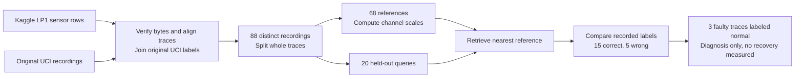
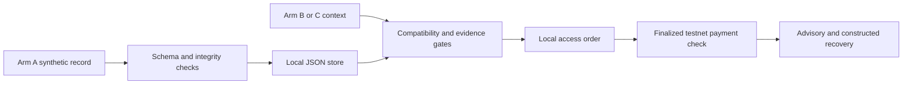

# ExperienceBridge

[](https://github.com/Sarthib7/RobExpbridge/actions/workflows/test.yml)

[Public simulation](https://exbridge.world) · [Solana devnet runbook](docs/solana-cli-demo.md) · [API and trust boundaries](docs/interfaces.md)

Minimal, deterministic proof that a simulator-tested recovery experience can be published by one arm, retrieved by a compatible arm before acting, and refused for incompatible hardware.

Advisories stay inside a constructed simulator. Physical robot control and hardware-backed confidential compute are outside this demo.

## What this demo proves

| Arm | Hardware | Without memory | With memory |
|---|---|---|---|
| A (contributor) | `arm-x` + `parallel-v1` | baseline slip | reduced-force success → publishes experience |
| B (compatible) | same relevant context | baseline slip | query → advisory → success (constructed) |
| C (incompatible) | `vacuum-v2` gripper | ; | rejected (`gripper mismatch`) |

All simulation outcomes are constructed and deterministic. They do not establish real-world performance or safety.

## Run the simulator

```bash
npm ci --ignore-scripts
npm run check
npm test
npm run demo
```

VERIFIED source (`package.json`, `src/server.ts`): requires Node.js 22+. `npm start` defaults to Agung mode on port 3334. It does not load `.env` automatically.

For the existing Solana CLI wallet, use the [devnet runbook](docs/solana-cli-demo.md). It requires an explicit contributor address. Starting the app does not send a payment.

VERIFIED source: `scripts/demo.ts` uses the simulator without funded wallets. CI runs the commands above on Node.js 22 and 24.

## Recorded robot-failure case study

VERIFIED [captured report](data/evidence/robot-failure-case-study-20261015.json): Kaggle/UCI LP1 supplies 88 recorded force/torque traces. The fixed split uses 68 references and 20 queries. Retrieval classified `15/20` correctly (75%), versus `7/20` (35%) for the reference-majority baseline.

Three of 15 faulty queries were classified as normal. These measurements follow failure detection. This study measures offline diagnosis, not recovery success, pre-failure prediction or robot safety. Recorded traces stay outside the paid advisory path.



Run `npm run case-study:robot` after installation. The command checks local source hashes and prints every prediction without network access or a wallet. Read the [full case study](docs/case-studies/robot-failures.md) for the protocol, all five errors and source rights. Original UCI attribution and CC BY 4.0 terms are retained; the manifest records Kaggle's different license metadata.

## Choose a demo

| Path | Command | Funds and prerequisites |
|---|---|---|
| Constructed simulator | `npm run demo` | No wallet or RPC |
| Public preview | [exbridge.world](https://exbridge.world) | No signing wallet; synthetic recovery only |
| Local EVM workspace | `npm run dev:local` | Foundry `anvil` on PATH; local test ETH only; port 3333 |
| Solana CLI wallet | [Runbook](docs/solana-cli-demo.md) | Existing devnet wallet and explicit contributor; port 3336 |
| Agung workspace | `npm start` | Generated test wallet needs AGUNG; port 3334 |

VERIFIED source: commands and defaults come from `package.json`, `scripts/local.ts`, `scripts/solana-cli-demo.ts` and `src/server.ts`. Stop a workspace with Ctrl+C. Starting a workspace does not send a payment.

## Architecture



VERIFIED source: `src/server.ts` connects matching, orders and simulation. The public Worker uses a separate unsigned path. It cannot create paid orders.

## Before exposing a service

VERIFIED source: signing workspaces bind to loopback. They have no multi-user identity layer. The JSON files require one owning runtime. These workspaces are for local testnet use.

Keep the signer on loopback. Use the unsigned Worker for a public preview. A shared service needs an explicit authentication and custody design, transactional storage, backup and recovery checks, and operational monitoring before real users or mainnet funds.

VERIFIED dependency check on 2026-10-14: `npm audit --omit=dev --json` returned `total: 0` advisories. This checks npm advisory data for the installed dependency tree; it does not prove the application is secure.

## API

| Method | Path | Purpose |
|---|---|---|
| `GET` | `/health` | Health + peaq mode |
| `POST` | `/experiences` | Validate, digest, publish |
| `GET` | `/experiences/:id` | Provenance, rights, evidence |
| `POST` | `/experiences/query` | Pre-execution match with reasons |
| `POST` | `/simulation/run` | Deterministic assembly scenario |
| `POST` | `/api/orders` | Create a compatible payment quote |
| `POST` | `/api/orders/:id/pay` | Prepare or rebroadcast the order payment |
| `POST` | `/api/orders/:id/verify` | Verify finalized payment evidence |
| `GET` | `/api/orders/:id/advisory` | Retrieve the paid advisory |
| `POST` | `/api/orders/:id/run` | Run the paid synthetic recovery |

VERIFIED source: routes above are defined in `src/server.ts`. Payment routes require the local client header and an order bearer token.

### Example query (Arm B)

```bash
curl -s http://127.0.0.1:3334/experiences/query -H 'x-experiencebridge-client: local-ui' -H 'content-type: application/json' -d '{
  "task": "connector_insertion",
  "context": {
    "robotModel": "arm-x",
    "gripper": "parallel-v1",
    "connector": "connector-demo",
    "material": "polymer-demo",
    "fixture": "fixture-7",
    "forceLimitN": 12
  },
  "use": "synthetic-demo"
}'
```

## Compatibility policy (fail closed)

Hard gates: task, robot model, gripper, material, fixture, force envelope, license, minimum evidence.

- Missing critical context → `requires_review`
- Hardware/context mismatch → `incompatible` (never silently downgraded)
- Expired, revoked, low evidence, bad digest → `rejected`

Evidence labels are never upgraded: `observed` < `simulation-tested` < `operator-approved` < `field-validated`.

Output is advisory only. No physical robot commands are issued.

## Integrity

Records are canonicalized (sorted keys) and hashed with SHA-256, excluding the `integrity` field. A matching digest proves integrity relative to a trusted hash ; not that physical observations were true.

## Payment and peaqOS status

VERIFIED source (`src/economics/runtime.ts`, `src/public-worker.ts`): local payment modes are EVM, Agung and Solana devnet. The public Worker provides an unsigned synthetic preview and rejects payment orders.

VERIFIED recorded evidence: [Solana devnet payment](data/evidence/solana-devnet-live-20261014.json) records a finalized 0.001 SOL transfer, slot `511057765`, fee `5000` lamports. See the [receipt and runbook](docs/solana-cli-demo.md). This verifies a devnet payment; the robot outcomes remain constructed.

VERIFIED recorded evidence (`data/evidence/peaqos-readiness.json`): the saved check returned `INSUFFICIENT_TEST_TOKENS` and `MACHINE_NOT_FOUND`, with a quoted bond of 0.4 AGUNG. This snapshot does not verify the current balance or registration. A computed machine ID does not prove registration.

REPORTED by the user on 2026-10-14: the peaq faucet is under maintenance. Activation remains pending. Do not treat the Solana receipt as peaq settlement.

Keep keys in ignored local storage. Do not commit `.env`, keypairs, bearer tokens or signed transaction bytes.

## dstack / TEE

Not integrated in v0.1. Local simulator / no-TEE mode must not be described as hardware-backed confidential compute.

## Project layout

```text
src/domain/schema.ts      # Zod schemas
src/memory/integrity.ts   # Canonical hash + verify
src/memory/store.ts       # Local JSON store
src/memory/match.ts       # Compatibility gates
src/sim/assembly.ts       # Deterministic simulator
src/economics/chain.ts    # EVM payment verification
src/economics/solana.ts   # Solana devnet payment adapter
src/economics/orders.ts   # Durable access orders
src/server.ts             # Fastify HTTP API
scripts/demo.ts           # One-command CLI demo
tests/*.test.ts
```

## What is real vs mocked

| Component | Status |
|---|---|
| Deterministic assembly simulator | Real (constructed rules) |
| Schema validation, store, match, digests | Real |
| HTTP API + CLI demo | Real |
| Payment adapters | VERIFIED source: local EVM, Agung and Solana devnet; receipt verification gates access |
| Solana payment | VERIFIED recorded finalized devnet receipt linked above |
| peaqOS activation | VERIFIED saved check blocked; current registration unverified |
| dstack attestation | Not present |
| ROS 2 / physical robots | Not present |
| Recovery fixtures | Synthetic only; recorded LP1 diagnosis data remains separate |

## Known limitations

- Single constructed connector-insertion scenario (`fixture-test-1`).
- No statistical transfer learning claim; before/after is 0/1 → 1/1 by design.
- No human review UI beyond typed `requires_review` status.
- No ROS/MCAP ingestion, revocation service network, or confidential matching.
- VERIFIED source (`scripts/peaqos-check.ts`): activation requires explicit configuration and a funded Agung wallet. No successful activation is established by the saved readiness report.

## License / rights

Demo experiences use `license: "demo-only"` with `redistribution: false`. Do not treat fixtures as redistributable factory data.
