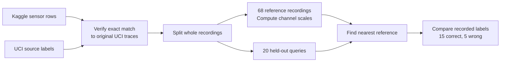

# Case study: retrieving similar recorded robot failures

2026-10-15. Evidence kind: offline diagnosis retrieval. Status: exploratory.

## Question and scope

Can reference memory retrieve a matching failure category from a held-out recorded trace more often than a majority-label baseline?

VERIFIED result on the fixed split: nearest-reference retrieval got 15 of 20 query labels correct (75%). The reference-majority baseline got 7 of 20 (35%). This is a 40 percentage-point difference on 20 queries from one source dataset. It is not a recovery-success rate, a safety result or evidence of transfer between factories.

## Data and rights

VERIFIED files: Kaggle `prashant111/robot-execution-failures`, version 1, LP1 CSV. Original labels: UCI Robot Execution Failures, DOI `10.24432/C5M89N`, by Luis Seabra Lopes and Luis M. Camarinha-Matos.

Sources: [Kaggle mirror](https://www.kaggle.com/datasets/prashant111/robot-execution-failures), [original UCI dataset](https://archive.ics.uci.edu/dataset/138/robot+execution+failures), [CC BY 4.0](https://creativecommons.org/licenses/by/4.0/).

VERIFIED source description: UCI identifies force/torque measurements collected after failure detection, in 15-sample windows over 315 ms. We checked file contents and source alignment. We did not independently verify the original collection hardware, calibrate the sensors or observe the experiments.

VERIFIED data audit: the Kaggle CSV contains six numeric columns but no labels. Its complete sequence of 1,320 rows exactly matches the original LP1 file. We attach a UCI label only after checking this alignment. All 88 LP1 traces are distinct. The channels follow the original order `Fx, Fy, Fz, Tx, Ty, Tz`; the study makes no SI-unit conversion claim.

VERIFIED license metadata differs: Kaggle lists CC0; UCI lists CC BY 4.0. This package credits both creators and the mirror and retains the original UCI terms. It does not claim that the mirror can remove the original conditions. Only unchanged LP1 text measurements are retained. No archive program or executable is used.

| Original category | Recordings |
| --- | ---: |
| normal | 21 |
| collision | 17 |
| obstruction | 34 |
| fr_collision | 16 |
| Total | 88 |

VERIFIED source manifest: [source files and hashes](../../data/case-studies/robot-failures/manifest.json). Both retained text files are unchanged. Scoped Git attributes disable line-ending conversion for these two files.

## Frozen protocol

VERIFIED protocol: chosen before the first scored probe and preserved with its timestamp in the data manifest and report. No parameter or split was changed after seeing the result.

1. Within each original category, sort whole recordings by SHA-256 of their canonical integer samples. Reserve the first `ceil(category count / 5)` for queries. Keep the rest as reference memory.
2. Use 68 reference recordings and 20 query recordings. Keep all 15 samples from each recording together. Reject duplicate traces; never place the same trace on both sides.
3. Compute one standard deviation per channel from reference-memory samples only. A zero scale becomes 1. Use all 90 values with this channel scaling.
4. Retrieve the reference with the smallest squared Euclidean distance. Break equal-distance ties by source episode ID. Predict only that reference's class label.
5. Compare with the most common reference-memory label, `obstruction`. Score held-out labels only after reference selection.

This is a fixed retrieval rule. The study trains no robot policy and sends no robot commands. Hardware compatibility is not inferred from signal distance. The recordings already follow failure detection, so this does not test pre-failure prediction.



## Results

VERIFIED [captured report with all query predictions](../../data/evidence/robot-failure-case-study-20261015.json):

| Metric | Similar-failure retrieval | Reference-majority baseline |
| --- | ---: | ---: |
| Correct query labels | 15 / 20 | 7 / 20 |
| Accuracy | 75% | 35% |
| Mean per-class recall | 74.11% | 25% |
| Fault recordings labeled normal | 3 / 15 | 0 / 15 |
| Normal recordings labeled faulty | 0 / 5 | 5 / 5 |

The majority baseline always predicts `obstruction`. It avoids the normal label but does not diagnose other categories well. Retrieval makes fewer total classification errors, but its three false-normal results rule out using this probe as a safety gate.

VERIFIED retrieval confusion counts. Rows are recorded labels; columns are retrieved labels.

| Recorded / retrieved | collision | fr_collision | normal | obstruction |
| --- | ---: | ---: | ---: | ---: |
| collision | 3 | 0 | 1 | 0 |
| fr_collision | 0 | 2 | 2 | 0 |
| normal | 0 | 0 | 5 | 0 |
| obstruction | 0 | 2 | 0 | 5 |

VERIFIED all five errors:

| Query | Recorded label | Retrieved reference | Predicted label |
| --- | --- | --- | --- |
| lp1-029 | collision | lp1-006 | normal |
| lp1-054 | obstruction | lp1-053 | fr_collision |
| lp1-072 | fr_collision | lp1-041 | normal |
| lp1-075 | fr_collision | lp1-007 | normal |
| lp1-081 | obstruction | lp1-059 | fr_collision |

## Reproduce and inspect

Run the offline study with the committed source files:

```sh
npm ci --ignore-scripts
npm run case-study:robot
node --import tsx --test tests/robot-failure-study.test.ts
```

The command reads local text files, validates their hashes and produces a JSON report. It needs no Kaggle login, network access, wallet or new package dependency. The report includes every query, its retrieved reference and both labels. Source hashes and split IDs make the run auditable.

VERIFIED checks: `tests/robot-failure-study.test.ts` reported `tests 8`, `pass 8`, `fail 0`. Setting every candidate distance to zero made the frozen-result check report `tests 1`, `pass 0`, `fail 1`, exit 1. Restoring the source returned eight passing tests. An independent Python probe agreed with TypeScript on every split ID, prediction and metric.

### CLI regression coverage

Correction from the fresh-eyes review: the original eight tests covered helpers and evaluation, but did not protect CLI wiring. Removing both CLI integrity calls left all eight passing. The current command already called those checks; the missing protection was in the test suite.

VERIFIED: five additional CLI tests reported `tests 5`, `pass 5`, `fail 0`. They run a copied command with isolated files and verify the intact report, corruption of either source, a changed frozen protocol and mismatched Kaggle rows. Source-corruption probes change whitespace while preserving numeric values, so parsing or alignment cannot hide a missing integrity check.

VERIFIED mutation checks in temporary copies: removing both integrity calls produced `tests 5`, `pass 3`, `fail 2`. Removing protocol validation or row alignment separately produced `tests 5`, `pass 4`, `fail 1`. Each mutation exited 1. Repository source remained unchanged.

Local hashes verify files against the committed manifest. They do not independently authenticate a changed manifest or verify the original laboratory observations. Source provenance also depends on the upstream attribution and the reviewed download records.

## Relationship to the MVP

VERIFIED source: `src/domain/schema.ts` and `src/sim/assembly.ts` support the constructed connector-insertion fixture. LP1 lacks established robot model, gripper, connector, material and fixture metadata, as well as measured recovery outcomes. These traces stay outside the paid advisory and recovery path.

The case study adds recorded-data diagnosis evidence beside the MVP. It does not upgrade the existing synthetic recovery to real-world validation, trigger a payment or establish peaqOS activation.

## Least confident decisions

1. The split holds out whole recordings but not a separate robot, site or collection session. Missing group metadata can hide correlation.
2. One nearest reference and channel scaling are simple fixed choices. The result is exploratory; a new protocol needs a fresh held-out evaluation.
3. The labels describe post-detection states. A future recovery case study needs paired interventions and measured outcomes, plus hardware context and usage rights.
