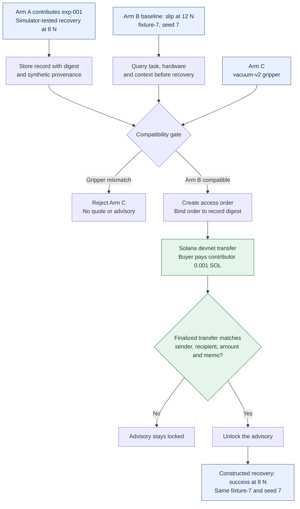

# MVP run evidence

Updated 2026-10-15. Owner: release.

VERIFIED: the MVP runs a deterministic recovery scenario and has one finalized Solana devnet payment. The payment uses test SOL. All robot inputs and outcomes are constructed. No physical robot telemetry or field dataset is supplied.

## Run at a glance

VERIFIED flow: the [paid run](data/evidence/solana-devnet-live-20261014.json) and [RPC recheck](data/evidence/solana-recheck-20261015.json) support the path below. Blue nodes show constructed robot data. Green nodes show the real devnet payment check.



VERIFIED boundaries: the public preview runs the synthetic recovery without payment and blocks access orders. The diagram shows the local paid path. peaqOS activation is a separate, pending integration. Neither path controls a physical robot.

## Correction to the earlier index

The 2026-10-13 index reported no confirmed public testnet payment. That was the recorded state then. A Solana devnet payment completed on 2026-10-14 and was checked again on 2026-10-15. The earlier blocked batches remain preflight failures, not successful payments.

The earlier test count was 63. VERIFIED [CI run 38709010147](https://github.com/Sarthib7/RobExpbridge/actions/runs/38709010147), head `7c4b516a2d5bbee26010f5c4a22e7414d91b688d`, reported `tests 78`, `pass 78`, `fail 0` on both Node 22 and Node 24. This verifies those checks, not production safety.

## What is real and what is constructed

| Evidence | Observed result | Boundary |
| --- | --- | --- |
| VERIFIED public Solana RPC | Finalized 0.001 SOL transfer | Real devnet payment with test tokens |
| VERIFIED paid app run | Confirmed order, advisory access, recovery success | Application record plus constructed simulator |
| VERIFIED fresh simulator run | Baseline slip, compatible recovery, incompatible rejection | Synthetic fixture, not physical robot data |
| VERIFIED public deployment | Healthy preview; orders return HTTP 403 | Unsigned simulator, no public payment signing |
| VERIFIED saved peaqOS report | Insufficient AGUNG; machine not found | Historical snapshot, not proof of activation |

## Real devnet transaction

VERIFIED [fresh RPC recheck](data/evidence/solana-recheck-20261015.json), collected on 2026-10-15 through `https://api.devnet.solana.com`:

| Field | Value |
| --- | --- |
| Network | Solana devnet |
| Signature | `3Bd94scCn2mFDeMPjAV9r7Kue6WC13dYXZkQHNGmFH2N5pp3AmRdPGAnouFN2dw2AtfEHMVMouLXeztQbYV263WN` |
| Confirmation | `finalized` |
| Transaction error | `null` |
| Slot | `511057765` |
| Transfer | `1000000` lamports (`0.001 SOL`) |
| Fee | `5000` lamports (`0.000005 SOL`) |
| Buyer | `EMc97zXSrG6vb8aqEMponNPgYcDJ9G5vLRYHJz1BYsge` |
| Contributor | `5Br4L66bZhvpErnaih7prwXwjk3VViz5SJ7Wa8Vk4cDF` |
| Order ID | `54a769d4-755f-4ac7-a1dc-34b15f86f00a` |
| Record digest | `cd2a85024abefd06981c8f182f101cbff5c23dbfb922238e15c6d4c17b86bf00` |

[Open the explorer receipt](https://explorer.solana.com/tx/3Bd94scCn2mFDeMPjAV9r7Kue6WC13dYXZkQHNGmFH2N5pp3AmRdPGAnouFN2dw2AtfEHMVMouLXeztQbYV263WN?cluster=devnet).

VERIFIED method: `getSignatureStatuses` used `searchTransactionHistory: true`. `getTransaction` used `commitment: finalized` and `encoding: jsonParsed`. Parsed sender, recipient and amount matched the recorded order. The memo matched the order ID and record digest. This recheck sent no new payment.

This evidence trusts the configured public RPC node. It is not an independent consensus proof. A transfer and memo do not establish that a robot performed a task or that an experience is true.

## The paid application run

VERIFIED [recorded run](data/evidence/solana-devnet-live-20261014.json):

1. Arm A contributed `exp-001` for a synthetic connector-insertion task, labeled `simulation-tested`.
2. Arm B ran the baseline at 12 N and returned `slip`. Matching returned `compatible` for its robot, gripper and context.
3. The app created an access order bound to the record digest. One 0.001 SOL devnet payment was submitted and finalized.
4. The confirmed order unlocked the advisory. Recovery succeeded at 8 N with seed 7 and the same fixture.
5. Arm C used `vacuum-v2` instead of `parallel-v1`. Matching returned `incompatible: gripper mismatch`.

The recorded run joins app state, payment fields and simulator outcomes. The fresh RPC recheck validates the public transaction. It does not independently replay or authenticate the historical application process.

## Fresh simulator run

VERIFIED [raw output](data/evidence/mvp-simulator-run-20261015.json). Command: `node --import tsx scripts/demo.ts`. Exit code: `0`. Capture runtime: `v26.8.1`. The CI run above used Node 22 and 24.

| Measurement | Baseline | Recovery |
| --- | --- | --- |
| Scenario | `fixture-test-1` | `fixture-test-1` |
| Fixture | `fixture-7` | `fixture-7` |
| Seed | `7` | `7` |
| Force | `12 N` | `8 N` |
| Outcome | `slip` | `success` |
| Constructed | `true` | `true` |

VERIFIED output: Arm C returned `incompatible`. Changing advisory bytes produced `tamperingDetected: true`. The run reported `baselineFailures: 1/1`, `recoverySuccesses: 1/1`, `incompatibleRejectionRate: 1/1`, and `repeatedFailuresAvoided: 1`.

VERIFIED local query time: `0.722417000000064 ms`. This is one in-process API call on one machine. It is not a network-latency, throughput or production benchmark. The 1/1 outcomes follow designed simulator rules, not a statistical effectiveness study.

The CLI prints a simulated peaq receipt with `transactionHash: null` and submits no payment. The real Solana transfer above came from the separate local payment workspace.

## Reproduce without spending tokens

VERIFIED source: `package.json` and `scripts/demo.ts` support:

```sh
npm ci --ignore-scripts
npm run demo
```

The command checks baseline, compatible recovery, incompatible hardware and tampering. Query time and temporary paths can differ.

Open [the public preview](https://exbridge.world), load the sample, run the baseline, check Arm B and run its recovery. Select Arm C to inspect rejection. VERIFIED source and deployment checks: the preview sends no payment.

For the paid path, use the [local Solana CLI wallet runbook](docs/solana-cli-demo.md). It requires a local devnet wallet and explicit contributor address. Starting the server does not pay. The payment action can spend devnet SOL. Inspecting the existing receipt does not require another payment.

## Public deployment

VERIFIED [deployment receipt](data/evidence/public-release-20261015.json): source `6ba2f4bfd1cd8495d4a0a49ae374ceb0f88a239a`, deployment `112f02ec-3cff-4b0e-8df5-c7734ead9e99`, version `ccb7486e-3027-4f9e-9150-2598a405759e`, 100 percent traffic at `2026-10-15T08:52:50.910075Z`.

VERIFIED at capture: HTML, JavaScript and CSS matched merged source. A 16,384-byte body returned HTTP 200; oversized UTF-8 input returned HTTP 413; Arm C returned HTTP 422; public orders returned HTTP 403. Recovery returned `paymentSent: false`.

These are timestamped checks, not continuous uptime measurements. The Worker embeds evidence at build time. An existing deployment can show an earlier evidence index until it is rebuilt.

## peaqOS and remaining gaps

VERIFIED [saved SDK report](data/evidence/peaqos-readiness.json): chain `9990`, `balanceWei: 0`, bond `400000000000000000` wei (0.4 AGUNG), `INSUFFICIENT_TEST_TOKENS`, `MACHINE_NOT_FOUND`, `transactionHash: null`. This snapshot does not establish the current balance or registration. A computed machine ID does not prove registration.

REPORTED by the user: the peaq faucet is under maintenance. Agung settlement and peaqOS activation remain unverified. The Solana devnet transfer does not establish either integration.

VERIFIED source and evidence scope: no physical robot dataset, private factory telemetry or hardware TEE attestation is supplied. A shared payment service still needs authentication, custody design and transactional storage before production use.

## Historical checks

VERIFIED [constructed batch report](data/evidence/simulation-batches.json): `total: 12`, `passed: 12`, `failed: 0`, `paymentTransactions: 0`. It covers compatibility, fixture mismatch, missing context, integrity, expiry, revocation, evidence and rights checks.

VERIFIED historical report contents: [Agung](data/evidence/checkpoint-20261013-agung.json) and [Solana devnet](data/evidence/checkpoint-20261013-solana-devnet.json) each contain 12 blocked preflight rows. Those rows prepared no transaction and do not count as completed payment runs.
